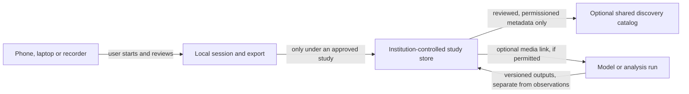

# Talk2Nature network and outreach plan

Updated October 20, 2026. This document describes a possible research-infrastructure direction, not a deployed service, approved protocol, partnership, or promise to accept data.

## What a university can use today

Talk2Nature can invite a lab to review synthetic observation sessions, the browser workflow, and selected local file-format tools. The public Station is user-started and foreground-only; audio and notes are not uploaded or saved by the browser. A person must export their own work. The public Compare exercise uses invented sessions. The private metadata workbench is local, owner-only, and synthetic-only. It is not a multi-user university service, and there is no cloud-hosted Talk2Nature recording store.

This is enough for a software/workflow review, not for a field study. It does not provide supported university installation, shared storage, account management for research groups, or an animal-communication model. A group with approved recordings should keep using its institution's authorized workflow; it may use the local tools only after its own data-rights and protocol review.

## Why not start with a global audio bucket?

The bird-audio ecosystem already includes open analysis software such as [BirdNET-Analyzer](https://birdnet.cornell.edu/analyzer/), archival submission guidance from the [Macaulay Library](https://support.ebird.org/en/support/solutions/articles/48001064341-audio-preparation-and-upload-guidelines), and biodiversity publishing/download conventions documented by [GBIF](https://techdocs.gbif.org/en/data-use/download-formats). These systems do different jobs and have their own terms, validation practices and communities. Rebuilding them would create storage, moderation, rights, privacy and maintenance obligations before Talk2Nature has shown a distinct user need.

The project hypothesis worth testing is narrower: researchers may need a simple way to retain observation context, uncertainty, device/session provenance and annotation history alongside media without turning a prediction into a ground-truth label. This is a hypothesis, not a demonstrated advantage. The network work should first establish whether real users have this problem and which existing formats or tools already solve it.

## A staged architecture, only after evidence

The diagram is a future option, not an implemented connection. Raw audio stays in the institution's study store by default; a media link appears only when the institution has authority to share it. A practical sequence is:

1. **Observe existing workflows.** Ask researchers to try the synthetic review. Learn what they use now, which context they cannot preserve, and which standards or repositories they must support. Do not ask them to upload research data.
2. **Specify one study with one institution.** If a repeated need emerges, the research lead and appropriate offices define the question, protocol, animal-welfare limits, human-participant review where applicable, consent, rights, data roles, access, retention, deletion/withdrawal, sensitive-location treatment, independent labels and evaluation. The institution chooses the approved storage and decides whether Talk2Nature code may handle any real data.
3. **Build only the missing connector.** Start with an export/import adapter or a small institution-controlled metadata service. Keep raw audio at the institution by default. Preserve source files and checksums, user-entered annotations, predictions, review decisions and model outputs as separate records. Make versioning and withdrawal testable before any multi-lab use.
4. **Consider a shared catalog only after repetition.** Several independent groups should demonstrate the same discovery need. Default to public, reviewed metadata and links controlled by the source institution; do not centralize raw audio automatically. Honor each media item's rights, participant permissions and location risk. A catalog entry must not imply open access to the underlying file.

Phones and laptops can be useful capture and review clients, but they are not standardized scientific sensors. Test the exact device, operating system, app path and frequency range against the intended protocol before making measurement claims. Keep capture user-visible and manually controlled; no unattended TV, assistant or background-recording promise is part of this plan.

## What Talk2Nature should be known for

Use a precise public description: **“Talk2Nature documents animal-communication research and builds open, local-first tools for careful observation, annotation and reproducible review.”** The long-term question of communicating with nature remains the inspiration. It is not a claim that software currently translates animal language.

Choose one concrete, species- and protocol-specific question for each pilot. A popular species is not automatically a sound scientific starting point: the question must have observable context, a plausible reference/annotation method, appropriate welfare and consent, and an independent way to review the result. Parrots may be a strong user-discovery cohort because caregivers can describe everyday context, but owner-recorded speech and home audio also bring selection, privacy and labeling issues that need a study design.

## How to earn attention without overclaiming

The first outreach goal is independent workflow feedback, not press coverage or data volume.

- Use the public [university evaluation page](https://metivity.github.io/talk2nature/community/university/) and [researcher starter kit](RESEARCHER_START.md) as the single entry point. Ask for one bounded task or one methods critique.
- Approach a small number of people individually: one bioacoustics/behavior researcher, one research-software or data-stewardship person, and one accessibility/field-methods reviewer. Personalize each invitation with a specific paper, workflow or published tool. Do not use mass outreach or imply a relationship.
- Invite existing-tool communities to point out overlap and interoperability gaps. Prefer a concrete adapter, reproducibility correction or upstream contribution over asking them to join another platform.
- Offer a short lab or research-software seminar only when the host asks. Show the synthetic demo, state the current limits, and end with one reproducible task. Do not collect recordings during the presentation.
- Publish one useful result per cycle: a verified source note, a corrected workflow, a small compatible export, or a clear decision that an existing tool is better. Include what was reviewed and what remains unknown.
- Track independent task completion, repeated workflow fit, concrete issues/PRs and maintained integrations. Views, downloads, stars and raw recording counts are not evidence that the project is useful.

The first outreach cycle can be small: up to five tailored invitations over a month, followed by a pause to learn from replies and failures. A successful cycle is at least one independent person completing or critically evaluating a task and identifying a specific next action. It does not require endorsement, partnership or a real-data pilot.

The current invitation and contact boundaries are in [UNIVERSITY_EVALUATION.md](UNIVERSITY_EVALUATION.md). Contact notes belong in the ignored private `funding/` workspace. No message has been sent by this plan.

## Sources reviewed

- [BirdNET-Analyzer](https://birdnet.cornell.edu/analyzer/), official research and software overview, checked October 20, 2026.
- [Macaulay Library: audio preparation and upload guidelines](https://support.ebird.org/en/support/solutions/articles/48001064341-audio-preparation-and-upload-guidelines), checked October 20, 2026. The guidance emphasizes preserving original recordings and limiting edits.
- [GBIF technical documentation: occurrence download formats](https://techdocs.gbif.org/en/data-use/download-formats), checked October 20, 2026. The documented Darwin Core Archive download includes associated multimedia information; GBIF is a discovery/publishing layer, not a substitute for local study governance.
