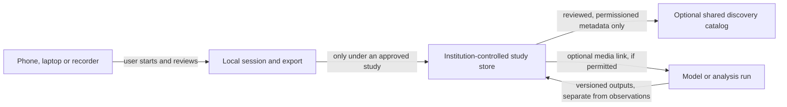

# Talk2Nature network and outreach plan

Updated October 23, 2026. This document describes a possible research-infrastructure direction, not a deployed service, approved protocol, partnership, or promise to accept data.

## What a university can use today

Talk2Nature can invite a lab to review synthetic observation sessions, the browser workflow, and selected local file-format tools. The public Station is user-started and foreground-only; audio and notes are not uploaded or saved by the browser. A person must export their own work. The public Compare exercise uses invented sessions. The private metadata workbench is local, owner-only, and synthetic-only. It is not a multi-user university service, and there is no cloud-hosted Talk2Nature recording store.

This is enough for a software/workflow review, not for a field study. It does not provide supported university installation, shared storage, account management for research groups, or an animal-communication model. A group with approved recordings should keep using its institution's authorized workflow; it may use the local tools only after its own data-rights and protocol review.

## Why not start with a global audio bucket?

The bird-audio ecosystem already includes open analysis software such as [BirdNET-Analyzer](https://birdnet.cornell.edu/analyzer/), archival submission guidance from the [Macaulay Library](https://support.ebird.org/en/support/solutions/articles/48001064341-audio-preparation-and-upload-guidelines), and biodiversity publishing/download conventions documented by [GBIF](https://techdocs.gbif.org/en/data-use/download-formats). These systems do different jobs and have their own terms, validation practices and communities. Rebuilding them would create storage, moderation, rights, privacy and maintenance obligations before Talk2Nature has shown a distinct user need.

The project hypothesis worth testing is narrower: researchers may need a simple way to retain observation context, uncertainty, device/session provenance and annotation history alongside media without turning a prediction into a ground-truth label. This is a hypothesis, not a demonstrated advantage. The network work should first establish whether real users have this problem and which existing formats or tools already solve it.

## A staged architecture, only after evidence

The diagram is a future option, not an implemented connection. Raw audio stays in the institution's study store by default; a media link appears only when the institution has authority to share it. A practical sequence is:

1. **Observe existing workflows.** Ask researchers to try the synthetic review. Learn what they use now, which context they cannot preserve, and which standards or repositories they must support. Do not ask them to upload research data.
2. **Specify one study with one institution.** If a repeated need emerges, the research lead and appropriate offices define the question, protocol, animal-welfare limits, human-participant review where applicable, consent, rights, data roles, access, retention, deletion/withdrawal, sensitive-location treatment, independent labels and evaluation. The institution chooses the approved storage and decides whether Talk2Nature code may handle any real data.
3. **Build only the missing connector.** Start with an export/import adapter or a small institution-controlled metadata service. Keep raw audio at the institution by default. Preserve source files and checksums, user-entered annotations, predictions, review decisions and model outputs as separate records. Make versioning and withdrawal testable before any multi-lab use.
4. **Consider a shared catalog only after repetition.** Several independent groups should demonstrate the same discovery need. Default to public, reviewed metadata and links controlled by the source institution; do not centralize raw audio automatically. Honor each media item's rights, participant permissions and location risk. A catalog entry must not imply open access to the underlying file.

Phones and laptops can be useful capture and review clients, but they are not standardized scientific sensors. Test the exact device, operating system, app path and frequency range against the intended protocol before making measurement claims. Keep capture user-visible and manually controlled; no unattended TV, assistant or background-recording promise is part of this plan.

## What Talk2Nature should be known for

Use a precise public description: **“Talk2Nature documents animal-communication research and builds open, local-first tools for careful observation, annotation and reproducible review.”** The long-term question of communicating with nature remains the inspiration. It is not a claim that software currently translates animal language.

Choose one concrete, species- and protocol-specific question for each pilot. A popular species is not automatically a sound scientific starting point: the question must have observable context, a plausible reference/annotation method, appropriate welfare and consent, and an independent way to review the result. Parrots may be a strong user-discovery cohort because caregivers can describe everyday context, but owner-recorded speech and home audio also bring selection, privacy and labeling issues that need a study design.

## How to earn attention without overclaiming

The first outreach goal is independent workflow feedback, not press coverage or data volume.

- Use the public [university evaluation page](https://metivity.github.io/talk2nature/community/university/) and [researcher starter kit](RESEARCHER_START.md) as the single entry point. Ask for one bounded task or one methods critique.
- Approach a small number of people individually: one bioacoustics/behavior researcher, one research-software or data-stewardship person, and one accessibility/field-methods reviewer. Personalize each invitation with a specific paper, workflow or published tool. Do not use mass outreach or imply a relationship.
- Invite existing-tool communities to point out overlap and interoperability gaps. Prefer a concrete adapter, reproducibility correction or upstream contribution over asking them to join another platform.
- Offer a short lab or research-software seminar only when the host asks. Show the synthetic demo, state the current limits, and end with one reproducible task. Do not collect recordings during the presentation.
- Publish one useful result per cycle: a verified source note, a corrected workflow, a small compatible export, or a clear decision that an existing tool is better. Include what was reviewed and what remains unknown.
- Track independent task completion, repeated workflow fit, concrete issues/PRs and maintained integrations. Views, downloads, stars and raw recording counts are not evidence that the project is useful.

The first outreach cycle can be small: up to five tailored invitations over a month, followed by a pause to learn from replies and failures. A successful cycle is at least one independent person completing or critically evaluating a task and identifying a specific next action. It does not require endorsement, partnership or a real-data pilot.

## Candidate reviewer paths checked October 23, 2026

These are fit hypotheses drawn from current public institutional pages, not prospects who have expressed interest. The same bounded ask applies to each: review a cited method or try the synthetic Compare exercise, then report one useful distinction and one missing field or unclear step. Do not send a generic invitation or describe any group as a partner.

| Candidate path | Public basis for fit | What the present project can ask | Boundary |
| --- | --- | --- | --- |
| **Cornell Lab of Ornithology — K. Lisa Yang Center for Conservation Bioacoustics / BioacousTalks (United States; open international forum)** | The Center describes work across computational bioacoustics, vocal communication, community science and terrestrial/marine monitoring. BioacousTalks describes a biweekly Zoom forum for passive-acoustic-monitoring practitioners, open to interested participants; its Fall 2026 schedule is still being planned. [Team](https://www.birds.cornell.edu/ccb/meet-our-team/) · [BioacousTalks](https://www.birds.cornell.edu/ccb/bioacoustalks/) | First learn from an open session. If a focused methods demo fits a future program, ask whether a short synthetic workflow review would be useful. | The current app is not a passive-acoustic monitoring or species-identification platform. The event page's schedule is incomplete; no registration or proposal has been made. |
| **Bar-Ilan University — Wildlife Behavioral Ecology and Endocrinology (Israel)** | The official profile describes individually marked wildlife observations joining vocalizations with social behavior and proximity, and names a project question about hyrax counter-songs. [Profile](https://dsai.biu.ac.il/team/prof-lee-koren/) | Ask whether the project's separation of signal, human observation, uncertainty and context matches the kinds of fields researchers need to review. | This is a metadata/workflow critique only. No group data or study participation is requested. |
| **Tel Aviv University — Bat Lab for Neuro-Ecology (Israel)** | The university profile describes vocal communication and field behavior, including wearable audio/video sensors and synchronized ultrasonic microphones with high-speed video. Prof. Yossi Yovel coauthored the 2017 source-dataset descriptor and 2016 bat-context study. [University profile](https://www.tau.ac.il/profile/yossiy) | Ask only for source-author clarification about provenance or method details if that would resolve a specific uncertainty. | Do not count source-author input as independent review of those works. Talk2Nature has not validated ultrasonic audio or synchronized audio-video workflows. |
| **University of St Andrews — Neurogenetics of Vocal Communication (United Kingdom)** | The official group page describes research on bat vocal learning and communication behavior. [Group profile](https://biology.st-andrews.ac.uk/research/research-group/neurogenetics-of-vocal-communication/) | Possible subject-matter fit for the bat-context review, if a reviewer is available and agrees to the bounded scope. | Prof. Sonja Vernes coauthored a separate 2025 Bat1K genomics paper with Yossi Yovel. Disclose and assess that collaboration before describing a review as independent; it is not an automatic disqualification. No contact or interest is claimed. |
| **University of St Andrews — Vincent Janik (United Kingdom)** | The School profile describes bottlenose-dolphin bioacoustics and vocal communication. [Profile](https://www.st-andrews.ac.uk/biology/people/vj/) | Possible literature-review fit for the separate dolphin whistle-structure candidate, after its own authorship/relationship screen. | This is not bat-specialist evidence and does not validate the bat-context candidate or the phone workflow. No contact or interest is claimed. |
| **Software Sustainability Institute community (United Kingdom; research-software network)** | The Institute describes a community for researchers and developers, workshops, and routes for sharing research-software work. [Community](https://www.software.ac.uk/community) | After an independent reviewer completes one task, consider sharing a short methods note or demo proposal about the reproducible workflow and its limits. | This is a community channel, not scientific validation or an endorsement. No blog or workshop proposal has been submitted. |

**First-wave decision:** for the bat-context candidate, seek a bat-behavior reviewer who is not an author of the source dataset or target prediction paper, plus a separate independent ML/statistical-evaluation reviewer. Disclose relevant collaborations with source authors before labeling a review independent. Source-author feedback may clarify their own work but does not satisfy this gate. Keep those research reviews separate from the public synthetic software task; no candidate is selected and no invitation has been sent.

The current invitation and contact boundaries are in [UNIVERSITY_EVALUATION.md](UNIVERSITY_EVALUATION.md). Contact notes belong in the ignored private `funding/` workspace. No message has been sent by this plan.

## Sources reviewed

- [BirdNET-Analyzer](https://birdnet.cornell.edu/analyzer/), official research and software overview, checked October 20, 2026.
- [Macaulay Library: audio preparation and upload guidelines](https://support.ebird.org/en/support/solutions/articles/48001064341-audio-preparation-and-upload-guidelines), checked October 20, 2026. The guidance emphasizes preserving original recordings and limiting edits.
- [GBIF technical documentation: occurrence download formats](https://techdocs.gbif.org/en/data-use/download-formats), checked October 20, 2026. The documented Darwin Core Archive download includes associated multimedia information; GBIF is a discovery/publishing layer, not a substitute for local study governance.
- [Cornell K. Lisa Yang Center for Conservation Bioacoustics team](https://www.birds.cornell.edu/ccb/meet-our-team/) and [BioacousTalks](https://www.birds.cornell.edu/ccb/bioacoustalks/), checked October 23, 2026. The forum is an open online passive-acoustics community; the fall 2026 schedule was still being planned.
- [Bar-Ilan University profile for Lee Koren](https://dsai.biu.ac.il/team/prof-lee-koren/), [Tel Aviv University profile for Yossi Yovel](https://www.tau.ac.il/profile/yossiy), and [University of St Andrews profile for Vincent Janik](https://www.st-andrews.ac.uk/biology/people/vj/), checked October 23, 2026. These establish topical fit only, not interest or availability.
- [St Andrews Neurogenetics of Vocal Communication group](https://biology.st-andrews.ac.uk/research/research-group/neurogenetics-of-vocal-communication/) and its [2025 Bat1K author list](https://doi.org/10.1038/s41586-024-08471-0), checked October 23, 2026. The group provides a bat vocal-learning fit hypothesis; the coauthorship with Yovel is a relationship to disclose, not proof of bias or endorsement.
- [Software Sustainability Institute community](https://www.software.ac.uk/community), checked October 23, 2026. Its community and workshop routes may suit a future reproducible software case; they do not evaluate animal-communication claims.

## Next shareable research update: monk-parakeet social structure

The new [field note](https://metivity.github.io/talk2nature/research/monk-parakeet-social-structure-2025/) is a concrete, modest outreach item: it explains how social-network evidence relates to vocal variation, calls out reuse of the 2023 cohort, and separates article, data and code rights. Lead with the useful method and the scientific boundary. Invite one targeted methods critique or workflow review; do not market it as a translation result, a new dataset release or an independent replication.

Suggested post, ready to adapt after publication:

> What can parrot social relationships tell us about their calls? A two-year monk-parakeet study linked social networks with vocal diversity across 5,599 calls from 229 birds. The results add context for studying call variation, but they do not decode call meanings or show what receivers understand. Talk2Nature has added a source-linked review that also tracks dataset/code rights and the overlap with earlier work. We welcome a focused methods review from parrot-bioacoustics, animal-behavior or research-data specialists: https://metivity.github.io/talk2nature/research/monk-parakeet-social-structure-2025/

Use the existing university evaluation page as the call to action for a bounded synthetic-workflow review. Start with a few individually relevant reviewers, log responses privately, and assess success by an independent reviewer completing a useful task—not likes, traffic or endorsements. This is a draft only; no invitation or post has been sent.

## October 23 share draft: choosing a dataset by its question

PR #250 adds a carefully bounded comparison of zebra-finch resources. The shareable point is that different datasets support different questions: V33DA is a caller-attribution candidate, ZF-AIM is a literature lead on vocal exchanges whose data rights are still unclear, bat recordings are a separate context-prediction candidate, and parrots remain the provisional companion-app discovery path. These are not interchangeable datasets, and none establishes animal-language translation. The public resource directory is live; the catalog records are metadata-only and no new audio or weights were acquired.

Suggested post, ready to adapt:

> “Big animal-sound datasets do not all answer the same question. Talk2Nature’s updated research library now separates caller attribution, vocal-exchange research, behavior-linked context and companion-animal observation—and records what each source still cannot show. For example, identifying which zebra finch called is a different task from learning what a call means. We reviewed the new leads as metadata only; no animal-language model or translation result is claimed. Researchers and research-software folks: what evidence or workflow gap should we review next? https://metivity.github.io/talk2nature/research/resources/”

For a more actionable invitation, pair the post with the no-account [synthetic researcher workflow](RESEARCHER_START.md) and ask for one reproducibility report or one specific correction. Keep the public claim to the documented review and software check; do not ask people to upload recordings. This is a draft only. No social post or invitation has been published or sent.
